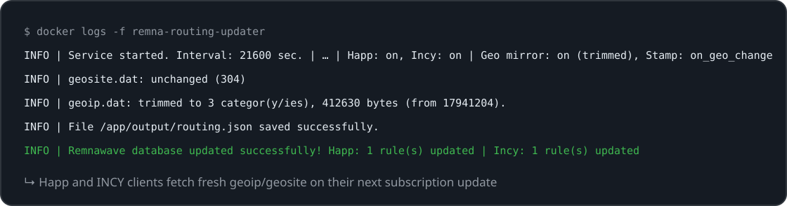
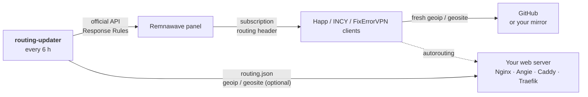

<p align="center">
  
</p>

<p align="center">
  <a href="https://github.com/3APA3A-3AHO3A/remnawave-routing-updater/releases/latest"></a>
  <a href="https://github.com/3APA3A-3AHO3A/remnawave-routing-updater/actions/workflows/ci.yml"></a>
  <a href="https://github.com/remnawave"></a>
  
  
  <a href="https://github.com/3APA3A-3AHO3A/remnawave-routing-updater/pkgs/container/remnawave-routing-updater"></a>
  <a href="LICENSE"></a>
</p>

<p align="center">
  <a href="#installation-and-launch">🚀 Install</a> &nbsp;·&nbsp; <a href="#environment-variables">⚙️ Configuration</a> &nbsp;·&nbsp; <a href="#geo-databases-mirror-and-trimming">🗺️ Geo mirror</a> &nbsp;·&nbsp; <a href="#web-server-reverse-proxy-setup">🌐 Reverse proxy</a> &nbsp;·&nbsp; <a href="#troubleshooting">🐞 Troubleshooting</a> &nbsp;·&nbsp; <a href="README.md">🇷🇺 Русский</a>
</p>

A standalone Python + Docker microservice that automatically keeps routing databases (`geoip`, `geosite`) up to date for **Happ**, **INCY** and **FixErrorVPN** (Windows) clients in the [Remnawave](https://github.com/remnawave) control panel.

The script talks to the **official Remnawave API** to update subscription settings, which makes it as safe as possible — no direct database access whatsoever. Logs are rotated automatically by Docker's built-in mechanism.

> [!TIP]
> **Quick start.** No cloning or building: download three files (`docker-compose.yml`, `.env`, `my-template.json`), put your API token into `.env` and run `docker compose up -d`. Step by step — [Installation and launch](#installation-and-launch).

> [!IMPORTANT]
> **What it changes in the panel.** Only the `routing` / `autorouting` headers of the Happ, INCY and FixErrorVPN response rules (a missing Happ / INCY rule is created above your catch-all; FixErrorVPN rules are never created). Nothing is ever deleted, disabled or reordered.

## What it looks like

<p align="center">
  
</p>

## Features

**Core**
- Talks only to the **official Remnawave API** (token-based) — no direct database access.
- Lightweight `Alpine Linux` Docker image; logs auto-rotated by Docker.
- Automatic retries on network errors and graceful shutdown on `docker stop`.
- Covered by a `pytest` suite and GitHub Actions CI (`ruff` + tests).

**Client support**
- Works on **Remnawave 2.x and 3.x** with the same image — the only API it writes to (Response Rules) is identical on both majors.
- **Happ and INCY are both supported out of the box**, handled by the exact same code path — one less thing to configure or get wrong.
- **FixErrorVPN (Windows app)** gets the same `routing` and `autorouting` headers with its own `fixerrorvpn://` scheme — in its own rules, which you create yourself.
- The routing link goes into the matching **Response Rule** and nowhere else. Custom response headers and any other header on the rule are never touched.
- Missing rule? For Happ and INCY it is **auto-created**, directly above your catch-all rule, so manual panel setup is optional.
- Generates the `routing.json` used by the `autorouting` feature of INCY and FixErrorVPN, and checks on startup that your reverse proxy actually serves it.

**Geo databases (`geoip` / `geosite`)**
- Default: stores and downloads nothing — just "nudges" clients to re-fetch fresh databases from the links in your template.
- **Self-hosted mirror** (`GEO_MIRROR_ENABLED`) — serve the databases from your own domain for regions where GitHub is blocked, with conditional `304` fetches and atomic writes.
- **Server-side trimming** (`GEO_TRIM_ENABLED`) — re-emit only the categories your template uses, shrinking the served files from ~10–17 MB to KB (the server-side equivalent of `UseChunkFiles`).
- **Change-aware re-stamping** (`STAMP_MODE=on_geo_change`) — bump `LastUpdated` and patch the panel only when the database actually changed.

**Delivery**
- Copy-paste reverse-proxy guides for **Nginx / Angie, Caddy and Traefik** (host and Docker variants).

## How it works



By default the script doesn't download or store the databases itself — and that's the elegant part.

The links to `geoip.dat` and `geosite.dat` (e.g. the Loyalsoldier repository) are baked right into your template and are **refreshed daily on GitHub's side**. The Happ/INCY clients download those databases themselves via the link — but only when they "notice" that the routing configuration has changed.

The script's job is to swap the `LastUpdated` timestamp in the configuration once per interval. That changes the resulting Base64 string, the client considers the routing updated and re-fetches the fresh databases from the links. So in this default mode the service downloads and stores nothing — it merely "nudges" clients to pull the latest databases, keeping load and risk to a minimum.

This default assumes clients can reach the database links. Where GitHub is blocked they can't — for that case the service can **optionally** mirror the databases itself (and even trim them); see [Geo databases](#geo-databases-mirror-and-trimming).

## Documentation

<details>
<summary><b>⚙️ Client support — Happ, INCY, FixErrorVPN, panel version</b></summary>

### Client support

Each client type is controlled by its own toggle in `.env`, so you enable only what you need.

All clients are handled the same way: the routing link is written into the `routing` header of the client's own **Response Rule** and nowhere else. INCY and FixErrorVPN additionally support `autorouting`, which Happ has no equivalent for. The routing string (Base64) is the same for everyone — only the scheme differs: `happ://`, `incy://`, `fixerrorvpn://`.

**Happ (`ENABLE_HAPP`) and INCY (`ENABLE_INCY`), both on by default.** For each enabled client the script updates the `routing` header of every response rule whose name contains `Happ` / `Incy` (case-insensitive), and creates one if none exists. Leaving a client enabled when you have no users on it costs one response rule and no requests, so there is rarely a reason to turn either off.

**FixErrorVPN (`ENABLE_FIXERRORVPN`), on by default.** The FixErrorVPN Windows app requests the subscription with the User-Agent `Xray-core/<ver> FixErrorVPN/<ver> (...)` or `mihomo/<ver> FixErrorVPN/<ver> (...)`. The script updates two headers on every rule whose name contains `FixErrorVPN` (case-insensitive; the substring is set by `FIXERRORVPN_RULE_MATCH`):

- `routing` = `fixerrorvpn://routing/onadd/<Base64>` — the same JSON Happ receives (`Geoipurl`, `Geositeurl`, `LastUpdated`, etc.);
- `autorouting` = `fixerrorvpn://autorouting/onadd/<AUTOROUTING_URL>` — the same `routing.json` as for INCY. Without `AUTOROUTING_URL` the header is not written, and a stale one is removed.

The app compares `LastUpdated` and the database URLs: when something changed, it re-downloads `geoip` / `geosite` in the background and applies them on the next connection.

**The script never creates FixErrorVPN rules** — not even with `CREATE_MISSING_RULES=true`. They need conditions on the app's User-Agent and a `responseType` per core, which is the panel owner's call. Create them yourself, e.g. `FixErrorVPN Xray` (`XRAY_JSON`, `user-agent` contains `FixErrorVPN` and `Xray-core`) and `FixErrorVPN Mihomo` (`MIHOMO`, `user-agent` contains `FixErrorVPN` and `mihomo`), and place them **above** the generic `Xray` and `Happ` rules — otherwise the app matches a generic rule and the `fixerrorvpn://` routing header never reaches it. With no matching rule at all you get a warning in the log and every other rule is left alone. The app's own headers in those rules (`fixerror-logo`, `fixerror-color`, `fixerror-buttons`, etc.) are never changed.

**INCY and FixErrorVPN autorouting.** Set `AUTOROUTING_URL` to your served `routing.json` (see the reverse proxy section below). It is optional: leave it unset and INCY and FixErrorVPN run on the `routing` header alone — the `autorouting` header is not written at all rather than pointing clients at a placeholder, and a stale one left on an existing rule is removed. On the first cycle the service fetches that URL and logs whether your reverse proxy actually serves the file it just wrote.

#### What the updater will and will not do to your rules

- Rules are matched **top-down, first hit wins**, and a request matching nothing gets `403`. A created rule is therefore inserted **directly above your catch-all rule** (the conditionless one Remnawave seeds as `Fallback Base64`) — appending it below would make it dead config.
- A created rule (Happ / INCY) **inherits the catch-all's `responseType`**, so your Happ/INCY users keep receiving exactly the subscription format they receive today; the only change is the added header. Override with `HAPP_RESPONSE_TYPE` / `INCY_RESPONSE_TYPE`, or set `CREATE_MISSING_RULES=false` to get a warning instead of a new rule.
- Rules that already exist keep their own `responseType`, `conditions`, `enabled` flag, position, and every header the updater does not manage (`support-email`, `announce-url`, …).
- Nothing is ever deleted, disabled or reordered, and nothing outside `responseRules` is written.

> 💡 Pre-create the rules manually if you need custom match conditions — the script fills in and keeps their headers up to date. See [response_rules.example.json](./response_rules.example.json) for the structure.

#### Panel version

`PANEL_VERSION=auto` (the default) detects the major version from the API response. You can pin it to `2` or `3`, but it changes nothing about what is sent: `GET`/`PATCH /api/subscription-settings` and the `responseRules` object it carries are identical on both majors.

Version 3.0.0 removed the dedicated `happRouting` field, and this updater no longer writes it. On a 2.x panel a leftover value there is still delivered to Happ clients as a second, now-stale `routing` header — you'll get a warning about it. Clear it in the panel, or set `CLEAR_LEGACY_HAPP_ROUTING=true` to have the updater null it once.

To use the API, create a token under **Remnawave Settings → API Tokens** with `Read/Write` permissions for the *Subscription Settings* section and copy it into your `.env` file.

</details>

<details>
<summary><b>🔧 Environment variables</b></summary>

### Environment variables

All parameters live in the `.env` file (created from `.env.example`):

| Variable | Purpose | Default |
| --- | --- | --- |
| `PANEL_URL` | Your panel URL (with `https://`, no trailing slash) | `http://remnawave:3000` |
| `API_TOKEN` | Remnawave API token (required) | — |
| `PANEL_VERSION` | Panel major version: `auto`, `2` or `3` | `auto` |
| `ENABLE_HAPP` | Enable Happ support (updates or creates the Happ rule) | `true` |
| `ENABLE_INCY` | Enable INCY support (updates or creates the Incy rule) | `true` |
| `ENABLE_FIXERRORVPN` | Enable support for the FixErrorVPN Windows app (only updates its rules, never creates them) | `true` |
| `HAPP_RULE_MATCH` / `INCY_RULE_MATCH` / `FIXERRORVPN_RULE_MATCH` | Substring used to find each client's rule by name (case-insensitive) | `happ` / `incy` / `fixerrorvpn` |
| `CREATE_MISSING_RULES` | Create a Happ / INCY rule above the catch-all when none matches (does not apply to FixErrorVPN) | `true` |
| `HAPP_RESPONSE_TYPE` / `INCY_RESPONSE_TYPE` | `responseType` for auto-created rules only; empty = inherit from the catch-all | — (inherit) |
| `CLEAR_LEGACY_HAPP_ROUTING` | Panel 2.x only: null out the legacy `happRouting` field | `false` |
| `AUTOROUTING_URL` | URL your web server serves `routing.json` from (optional; enables `autorouting` for INCY and FixErrorVPN — unset = `routing` only) | — (unset) |
| `UPDATE_INTERVAL_SECONDS` | Update interval in seconds | `21600` (6 hours) |
| `REQUEST_TIMEOUT_SECONDS` | HTTP request timeout for the API | `30` |
| `RETRY_ATTEMPTS` | Number of retries on a network error | `3` |
| `GEO_MIRROR_ENABLED` | Download `geoip.dat` / `geosite.dat` to this server | `false` |
| `GEOIP_URL` / `GEOSITE_URL` | Public `.dat` URLs handed to clients (empty = template default) | — |
| `GEOIP_SOURCE_URL` / `GEOSITE_SOURCE_URL` | Upstream the server pulls the databases from | Loyalsoldier GitHub |
| `STAMP_MODE` | `LastUpdated` bump: `interval` or `on_geo_change` | `interval` |
| `GEO_TRIM_ENABLED` | Serve only the template's categories (server-side `UseChunkFiles`) | `false` |

</details>

<details>
<summary><b>🚀 Installation and launch</b></summary>

### Installation and launch

The service ships as a prebuilt image on the **GitHub Container Registry**, so there's nothing to clone or build — just grab three files into an empty folder and start it.

1. Create a folder and download the files:
   ```bash
   mkdir remnawave-routing-updater && cd remnawave-routing-updater
   curl -O https://raw.githubusercontent.com/3APA3A-3AHO3A/remnawave-routing-updater/master/docker-compose.yml
   curl -o .env https://raw.githubusercontent.com/3APA3A-3AHO3A/remnawave-routing-updater/master/.env.example
   curl -o my-template.json https://raw.githubusercontent.com/3APA3A-3AHO3A/remnawave-routing-updater/master/template.json
   ```

2. Set up the configuration:
   ```bash
   nano .env
   ```
   *Paste your `API_TOKEN`, set `PANEL_URL`, and enable the clients you need (`ENABLE_HAPP` / `ENABLE_INCY` / `ENABLE_FIXERRORVPN`). For INCY and FixErrorVPN, also set `AUTOROUTING_URL`.*

3. Edit your routing template `my-template.json`:
   ```bash
   nano my-template.json
   ```
   Add your own rules (`DirectSites`, bypass databases, etc.). **Note:** do not add the `LastUpdated` field — the script generates it automatically.

4. Start the service (pulls the image from GHCR):
   ```bash
   docker compose up -d
   ```

5. View the logs:
   ```bash
   docker logs -f remna-routing-updater
   ```

To update later, pull the newest image and recreate: `docker compose pull && docker compose up -d`.

<details>
<summary>Build from source instead (for development)</summary>

If you want to modify the code, clone the repo and build locally. Replace the `image:` line in `docker-compose.yml` with `build: .`, then:

```bash
git clone https://github.com/3APA3A-3AHO3A/remnawave-routing-updater.git
cd remnawave-routing-updater
cp .env.example .env && nano .env
cp template.json my-template.json && nano my-template.json
docker compose up -d --build
```
> 💡 We work with `my-template.json` (not tracked by git) so your edits don't conflict on `git pull`; `template.json` stays as the reference.
</details>

</details>

<details>
<summary><b>✅ Verifying it works</b></summary>

### Verifying it works

On a successful start you'll see lines like these in the logs:
```
Service started. Interval: 21600 sec. | API: https://panel.your-domain.com | Happ: on, Incy: off, FixErrorVPN: off | Geo mirror: off, Stamp: interval
File /app/output/routing.json saved successfully.
✅ Remnawave database updated successfully! Happ: field set, 1 rule(s) updated
```
The `./output/routing.json` file should appear on disk, and `https://sub.your-domain.com/routing.json` (after setting up the reverse proxy below) should serve valid JSON.

The container also reports a Docker health status: `docker ps` shows `healthy` once the first cycle completes, and flips to `unhealthy` if the loop stalls for longer than one update interval — handy for `restart: unless-stopped` setups and external monitoring.

</details>

<details>
<summary><b>🗺️ Geo databases — mirror and trimming</b></summary>

### Geo databases (mirror and trimming)

Where GitHub is blocked, you can serve the databases yourself and even shrink them to what your template uses.

Happ/INCY clients download `geoip.dat` / `geosite.dat` from the URLs in your template
(`Geoipurl` / `Geositeurl`) — by default from GitHub. Where GitHub is blocked these downloads
fail on the client, which breaks routing. This service can mirror both databases onto your own
server (next to `routing.json`) and hand clients your domain instead.

**How it works.** Each cycle the service downloads the databases from upstream (GitHub is
reachable from most servers) with a conditional request — unchanged files return `304` and are
skipped — and writes them atomically, so the proxy never serves a half-written file. The client
still downloads the **full** file and trims it locally (`UseChunkFiles`), so you only ever host
**two static files** — no chunk manifests, no special naming.

**Enable it** in `.env`:
```dotenv
GEO_MIRROR_ENABLED=true
GEOIP_URL=https://sub.your-domain.com/geoip.dat
GEOSITE_URL=https://sub.your-domain.com/geosite.dat
```
`GEOIP_URL` / `GEOSITE_URL` are what clients receive; leave them empty to keep the template's
GitHub defaults. Keep `template.json` pointing at GitHub so deployments where GitHub is reachable
work out of the box — the switch lives entirely in `.env`. The databases land in the same `./output` folder as
`routing.json`, so the reverse-proxy examples below serve all three files together.

**Trim the databases to what the template uses (optional, `GEO_TRIM_ENABLED=true`).** This is
the server-side equivalent of `UseChunkFiles`: instead of serving the full ~10–17 MB files, the
service downloads them into a private cache and re-emits **only the categories your template
references** (`geosite:`/`geoip:` entries in `DirectSites`/`ProxySites`/`BlockSites` and the IP
fields) into the served `.dat`. A template that uses only `geosite:private`, `geosite:category-ads-all`
and `geoip:private` shrinks `geosite.dat` from ~10 MB to a few hundred KB and `geoip.dat` from
~17 MB to a few KB. Clients then pull a tiny file — a big win over throttled/DPI'd links. The
trim runs each cycle and re-detects changes automatically when either the upstream database or the
template's category set changes. Needs `GEO_MIRROR_ENABLED`; the full files stay in `./output/.cache`
and are never served.

**Re-stamp only when the database changes (optional).** By default (`STAMP_MODE=interval`) the
`LastUpdated` stamp — which tells clients to re-download the geo files — is bumped every cycle.
With the mirror on you can switch to `STAMP_MODE=on_geo_change`: the stamp advances (and the
panel is patched) **only when the served database actually changed**. That change is detected
for free from the mirror's conditional request (and, with trimming on, from the trimmed output),
so you can lower `UPDATE_INTERVAL_SECONDS` to poll more often without re-writing the panel or
nudging every client each cycle. One interval covers both jobs — no separate poll setting is needed.

</details>

<details>
<summary><b>🌐 Web server (reverse proxy) — Nginx, Angie, Caddy, Traefik</b></summary>

### Web server (Reverse Proxy) setup

**Why is this needed?** The `autorouting` feature of INCY and FixErrorVPN periodically downloads `routing.json` from a direct link, and — if you enabled the geo mirror above — clients fetch `geoip.dat` / `geosite.dat` the same way. The script writes all of them into the local `./output` folder; your web server exposes them at public URLs.

Serve them from your **subscription domain** — the client already refreshes its subscription there, so these files belong on the same host. Examples use `https://sub.your-domain.com/routing.json`, `…/geoip.dat` and `…/geosite.dat`.

> ⚠️ **The public URLs must exactly match `AUTOROUTING_URL` / `GEOIP_URL` / `GEOSITE_URL` in your `.env`,** or the client silently falls back or fails.

These examples extend the official Remnawave reverse-proxy setups ([docs.rw/install/reverse-proxies](https://docs.rw/install/reverse-proxies/)), which document **Caddy, Nginx, Traefik and Angie**. Remnawave itself must stay on the domain root (it does not support running under a sub-path), but serving a few static files next to it is fine — the subscription page stays at `/`, we just carve out `/routing.json` and the two `.dat` paths. `routing.json` is sent with `Cache-Control: no-store` (always fresh); the rarely-changing `.dat` files are cached. Every example assumes the official subscription container `remnawave-subscription-page` on port `3010`.

> The `.dat` blocks are needed **only if `GEO_MIRROR_ENABLED=true`**. Not using the mirror? Skip them and serve `/routing.json` alone.

> ⚠️ **Match `geoip`/`geosite` broadly, not just `\.dat$`.** Clients also probe `<file>.dat.sha256` before downloading. If the location only matches `.dat`, that probe falls through to `location /` and gets proxied to the subscription backend (port `3010`) — a flood of these can overwhelm it and break real subscription updates. The broad `^/(geoip|geosite)\.` match keeps every geo request on nginx and returns a **static 404** for the missing checksum (exactly what GitHub does — the checksum is optional).

> Running HAProxy in front? It's usually a TCP/port balancer rather than an HTTP proxy — terminate HTTPS on the Nginx/Caddy/Angie behind it and serve these paths there using the matching example below.

> 📦 **Panel 3.x: enable compression on the proxy.** Since Remnawave 3.0.0 the panel no longer compresses response bodies itself. In Caddy add `encode` to both site blocks; in Nginx add `gzip on;` plus a `gzip_types` list that includes `application/json` and `text/plain`. Behind a CDN, follow the CDN's guidance instead — it usually compresses for you.

After setup, verify:
```bash
curl -I https://sub.your-domain.com/routing.json   # 200, Content-Type: application/json, Cache-Control: no-store
curl -I https://sub.your-domain.com/geoip.dat      # 200, Content-Type: application/octet-stream  (mirror only)
```

#### 🟢 Nginx & 🟣 Angie

Angie is an Nginx fork, so the same block works for both. Add it to the `server { ... }` that serves your subscription domain, *before* the main `location /`.

##### Option A: proxy on the host (no Docker)
```nginx
location = /routing.json {
    alias /opt/remnawave-routing-updater/output/routing.json;
    types { } default_type application/json;
    add_header Cache-Control "no-store" always;
}

# Geo databases — only if GEO_MIRROR_ENABLED=true
location ~ ^/(geoip|geosite)\. {
    root /opt/remnawave-routing-updater/output;
    default_type application/octet-stream;
    add_header Cache-Control "public, max-age=86400";
    try_files $uri =404;
}
```
*Apply:* `nginx -s reload` (or `angie -s reload`)

##### Option B: proxy running in Docker
1. Mount the output folder into the proxy container (its `docker-compose.yml`):
```yaml
    volumes:
      - /opt/remnawave-routing-updater/output:/usr/share/nginx/routing_output:ro
```
*Recreate:* `docker compose up -d`
2. Point the locations at the internal path:
```nginx
location = /routing.json {
    alias /usr/share/nginx/routing_output/routing.json;
    types { } default_type application/json;
    add_header Cache-Control "no-store" always;
}

# Geo databases — only if GEO_MIRROR_ENABLED=true
location ~ ^/(geoip|geosite)\. {
    root /usr/share/nginx/routing_output;
    default_type application/octet-stream;
    add_header Cache-Control "public, max-age=86400";
    try_files $uri =404;
}
```
*Apply:* reload the proxy container (`docker exec <proxy> nginx -s reload`).

---

#### 🔵 Caddy

> ⚠️ **Important:** wrap the file serving in a `handle` block, otherwise `reverse_proxy` intercepts the request.

##### Option A: Caddy on the host (no Docker)
```caddyfile
https://sub.your-domain.com {
    # 1. Serve the static JSON
    @routing path /routing.json
    handle @routing {
        root * /opt/remnawave-routing-updater/output
        file_server
        header Content-Type application/json
        header Cache-Control no-store
    }

    # 2. Geo databases — only if GEO_MIRROR_ENABLED=true
    @geo path /geoip.dat* /geosite.dat*
    handle @geo {
        root * /opt/remnawave-routing-updater/output
        file_server
        header Content-Type application/octet-stream
        header Cache-Control "public, max-age=86400"
    }

    # 3. Everything else goes to the subscription page
    reverse_proxy * http://127.0.0.1:3010
}
```
*Apply:* `systemctl reload caddy`

##### Option B: Caddy in Docker
1. Mount the output folder into the Caddy container:
```yaml
    volumes:
      - /opt/remnawave-routing-updater/output:/usr/share/caddy/routing_output:ro
```
*Recreate:* `docker compose up -d`
2. Point `root *` at the mounted path and proxy to the subscription container by name:
```caddyfile
https://sub.your-domain.com {
    @routing path /routing.json
    handle @routing {
        root * /usr/share/caddy/routing_output
        file_server
        header Content-Type application/json
        header Cache-Control no-store
    }

    # Geo databases — only if GEO_MIRROR_ENABLED=true
    @geo path /geoip.dat* /geosite.dat*
    handle @geo {
        root * /usr/share/caddy/routing_output
        file_server
        header Content-Type application/octet-stream
        header Cache-Control "public, max-age=86400"
    }

    reverse_proxy * http://remnawave-subscription-page:3010
}
```
*Apply:* `docker exec -w /etc/caddy your_caddy_container caddy reload`

---

#### 🟠 Traefik

Traefik is a proxy, not a file server, so run a tiny static-file container on the same `remnawave-network` and route `/routing.json` (and, with the mirror on, the geo databases) to it. The container already mounts the whole `./output` folder, so all three files are available:
```yaml
  routing-file:
    image: nginx:alpine
    container_name: remna-routing-file
    restart: unless-stopped
    networks:
      - remnawave-network
    volumes:
      - /opt/remnawave-routing-updater/output:/usr/share/nginx/html:ro
```
The official Remnawave Traefik setup uses the **file provider** (a dynamic-config file), so add a router there:
```yaml
http:
  routers:
    routing-json:
      rule: "Host(`sub.your-domain.com`) && Path(`/routing.json`)"
      entryPoints:
        - https
      service: routing-file
      priority: 1000          # win over the subscription router for this path
      tls:
        certResolver: letsencrypt
      middlewares:
        - routing-nostore
    # Geo databases — only if GEO_MIRROR_ENABLED=true (cacheable, separate middleware)
    geo-files:
      rule: "Host(`sub.your-domain.com`) && (Path(`/geoip.dat`) || Path(`/geoip.dat.sha256`) || Path(`/geosite.dat`) || Path(`/geosite.dat.sha256`))"
      entryPoints:
        - https
      service: routing-file
      priority: 1000
      tls:
        certResolver: letsencrypt
      middlewares:
        - geo-cache
  services:
    routing-file:
      loadBalancer:
        servers:
          - url: "http://remna-routing-file:80"
  middlewares:
    routing-nostore:
      headers:
        customResponseHeaders:
          Cache-Control: "no-store"
    geo-cache:
      headers:
        customResponseHeaders:
          Cache-Control: "public, max-age=86400"
```
Match `entryPoints`/`certResolver` to your `traefik.yml`. *Recreate:* `docker compose up -d`

> If your Traefik instead uses the Docker label provider, drop the YAML above and put equivalent labels on the `routing-file` service: the `routing-json` router (`...rule=…Path(/routing.json)`, `...priority=1000`, `...service=routing-file`, `...loadbalancer.server.port=80`, middleware `routing-nostore`) and — with the mirror on — the `geo-files` router (`...rule=…Path(/geoip.dat)||Path(/geoip.dat.sha256)||Path(/geosite.dat)||Path(/geosite.dat.sha256)`, same service, middleware `geo-cache`).

</details>

<details>
<summary><b>🐞 Troubleshooting</b></summary>

### Troubleshooting

**Startup / API**
- **`CRITICAL ERROR: API_TOKEN is not set`** — `API_TOKEN` is empty in `.env`.
- **`CRITICAL ERROR: ENABLE_HAPP, ENABLE_INCY and ENABLE_FIXERRORVPN are all disabled`** — enable at least one client.
- **`No response rule matching 'fixerrorvpn' found — FixErrorVPN routing was not delivered`** — the panel has no FixErrorVPN rule. The script does not create one: add rules matching the app's User-Agent above the generic `Xray` / `Happ` rules (see [Client support](#client-support)), or set `ENABLE_FIXERRORVPN=false` if nobody uses the app.
- **`AUTOROUTING_URL check: ... returned HTTP 404`** — the reverse proxy is not serving `routing.json`. Compare the `location` block against the volume this container writes to; the URL in `.env` must match the public one exactly, including `https://`.
- **`AUTOROUTING_URL check: ... serves a different/older file`** — the proxy points at a different directory than the one the container writes to. Check the volume mapping on both sides.
- **The log says success, but Happ/INCY users get no routing profile** — open *Subscription Settings → Response Rules* and check the rule order. Rules are matched top-down and the first hit wins, so a rule sitting below the conditionless `Fallback Base64` rule never fires. Move it above.
- **`AUTOROUTING_URL not set … autorouting header is skipped`** — not an error: INCY and FixErrorVPN run on the `routing` header only. Set a real link in `.env` to enable the `autorouting` feature.
- **`API error: 'response' object not found`** — wrong `PANEL_URL`, or a token without `Subscription Template: Read/Write`.

**Config changes don't take effect** — after editing `.env` or `my-template.json`, recreate the container: `docker compose up -d --force-recreate`. If you're on an outdated image, pull first: `docker compose pull && docker compose up -d`. (Building from source? Rebuild with `docker compose up -d --build`.)

**`/routing.json` returns HTML instead of JSON** — the reverse proxy is intercepting the request; check the setup above (Caddy needs a `handle` block, Traefik a higher router priority).

**Geo files / subscription flapping** (only relevant with the mirror on):
- **`/geoip.dat` returns 200 but from the wrong place, or `502`/`upstream prematurely closed` on `/geoip.dat.sha256`, `/sub/…`, `/assets/…`** — geo requests are being proxied to the subscription backend (port `3010`) instead of served statically, and can overwhelm it. Match `geoip`/`geosite` **broadly** (`location ~ ^/(geoip|geosite)\.`), not just `\.dat$`: clients also probe `<file>.dat.sha256`, which must return a **static 404**, not hit the backend. Then reload nginx and restart the subscription container once.
- **Trimmed `.dat` looks empty / `categories not found in source`** in the logs — the category names in your template don't match the source database. Check the `geosite:`/`geoip:` names in `my-template.json` against the upstream categories.
- **`geoip`/`geosite` reported `invalid` in the Happ log even though the file isn't broken** (`Geo files validation failed … geoip=invalid (size=240 bytes)`) — trimming down to a single tiny category (e.g. only `geoip:private`, ~240 bytes) produces a file Happ rejects as too small (a guard against truncated/corrupted downloads); the protobuf itself is structurally valid. Fix: keep at least one substantial category in the served file — e.g. add `geoip:google` (~126 KB) or `geoip:cloudflare` (~9 KB) to the relevant IP field of your template. `geoip.dat` then becomes a few hundred KB and passes validation while staying tiny next to the full ~17 MB. (Watch out for small categories: `geoip:telegram`, for instance, is only ~181 bytes and would also fail.)

</details>

<details>
<summary><b>🧪 Development</b></summary>

### Development

See [CONTRIBUTING.md](CONTRIBUTING.md): project layout, dev setup and the checks CI runs (`ruff check .`, `pytest -q`). Every push to `master` and every `v*` tag publishes a multi-arch image (`amd64`, `arm64`) to [GHCR](https://github.com/3APA3A-3AHO3A/remnawave-routing-updater/pkgs/container/remnawave-routing-updater).

- [Dependabot](.github/dependabot.yml) opens weekly PRs for new versions of `requests`, `python-dotenv`, the base image and GitHub Actions.
- Release: bump the version in `pyproject.toml` and `routing_updater/__init__.py`, add a section to [`CHANGELOG.md`](CHANGELOG.md) (in Russian), then `git tag vX.Y.Z` and `git push origin vX.Y.Z` — [`release.yml`](.github/workflows/release.yml) checks the versions and creates a release with the text from the CHANGELOG.

</details>

## License

Distributed under the MIT License — see the [LICENSE](./LICENSE) file.
